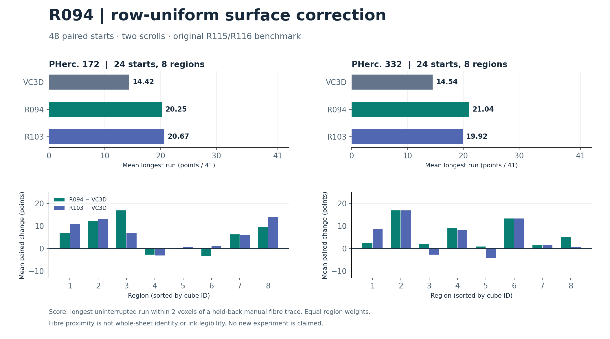
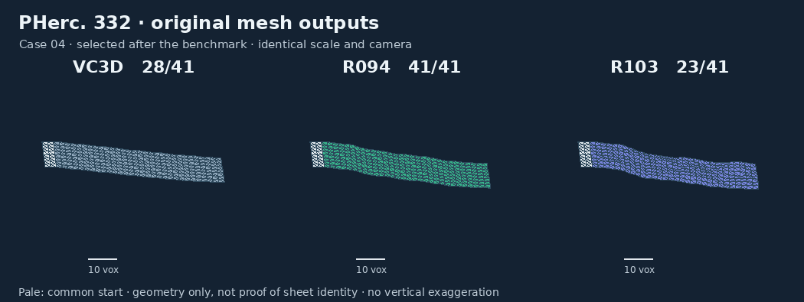
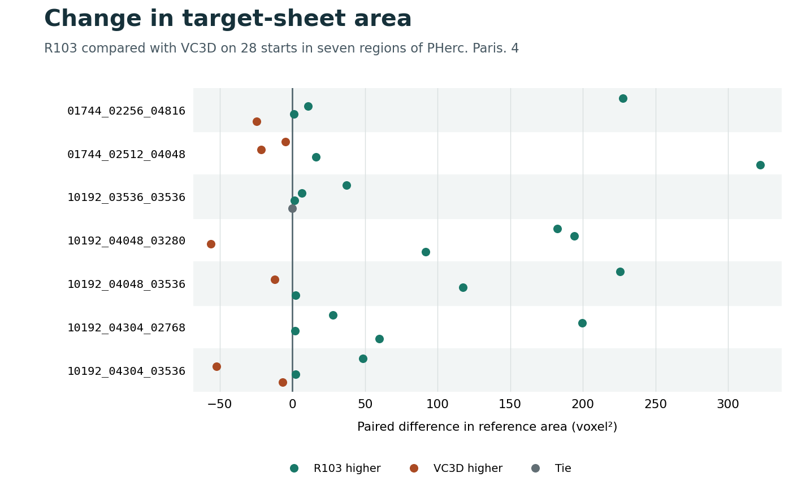
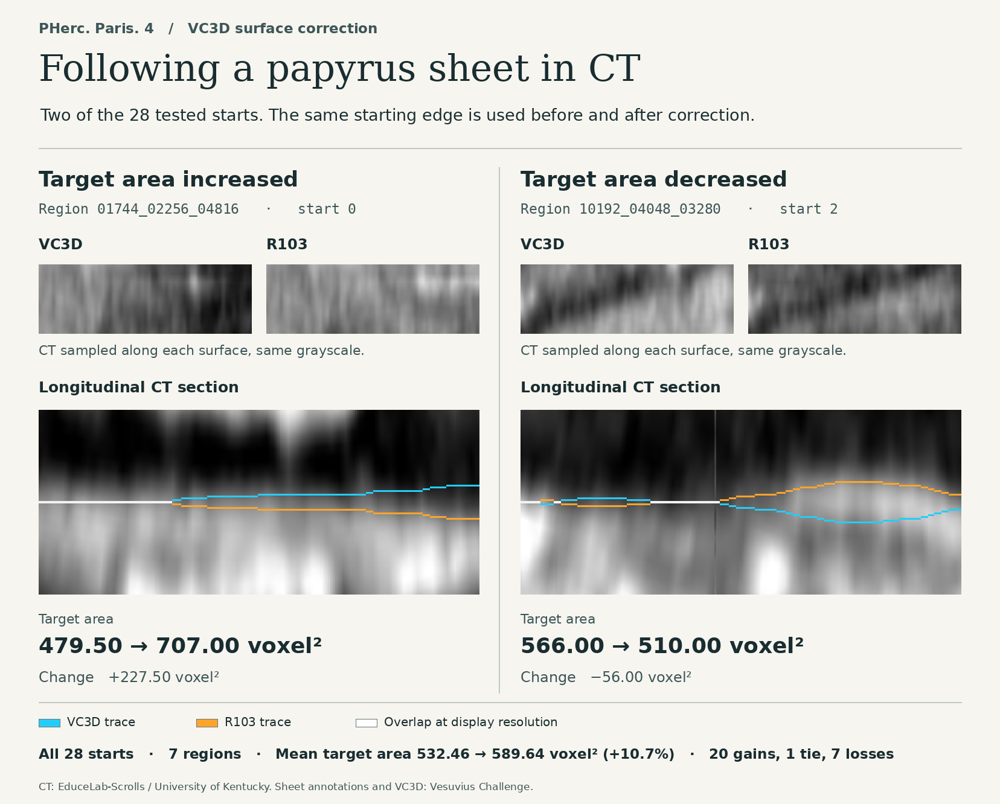
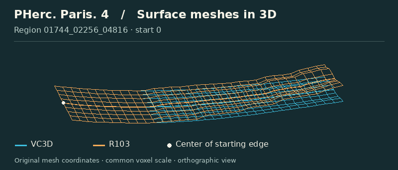

# R103 · CT-guided correction for VC3D edge extensions

R103 adjusts a narrow surface strip after VC3D has extended it. If the mesh strays onto a neighbouring sheet, any downstream ink detector can sample the wrong page. R103 uses the local CT signal and the original starting edge to choose a correction. It writes a standard `tifxyz` surface that can be reopened in VC3D.

## R094 · row-uniform correction

R094 is the row-uniform CT-guided method already included in the submitted R103 code. The original comparison on PHerc. Paris. 4 is below. Follow-up tests on PHerc. 172 and PHerc. 332 (24 starts each) found that R094 improved mean contiguous fibre proximity over VC3D on both scrolls. On PHerc. 332 it reached **21.04 vs 14.54 points (+44.7%)**, with improvement in all eight regional means; R103 reached 19.92. R094 does not always win and increased mean other-sheet area on the original Paris. 4 panel.

[Method, examples, provenance and reproducibility](r094/README.md) · [All 48 paired scores](r094/paired-scores.csv) · [Download the rotatable 3D mesh viewer](r094/r094-3d.html) (open the downloaded HTML locally).

**Fresh replay (26 November 2026):** all five illustrative cases regenerated bit-identical VC3D and R094 coordinates using the original pinned VC3D build (10/10 meshes, 25 native calls). R103 was not rerun in this check. [Reproduction evidence](r094/replay-verification.json).

This supplement documents the existing method and previously published follow-up results; it is not a new algorithm or a separate prize submission. The fibre metric is not a measurement of letter legibility or complete sheet identity. The supplement includes generated mesh outputs, not source CT voxels or original manual annotation traces. The shared starting strip is oriented using a short initial manual indication.

## Results on PHerc. Paris. 4

The correction was fixed before testing in seven previously unused regions of this scroll. All three methods completed the same 28 starts, four in each region.

| Method | Mean area on the target sheet (voxel²) | Mean area on another sheet (voxel²) |
| --- | ---: | ---: |
| VC3D edge extension | 532.46 | 0.89 |
| Uniform correction (R094) | 559.36 | 1.89 |
| R103 | 589.64 | 0.11 |

Compared with VC3D, R103 gained **57.18 voxel² per start on average (+10.7%)**. Six of the seven regional means increased. The figure shows each individual start, including the largest loss (56.00 voxel², region `10192_04048_03280`, start 2). The metric measures where the mesh lies relative to sheet annotations. It does not measure ink legibility or time saved by an operator.

[All paired scores](results/paired_scores.csv) · [Reproduction instructions and metric](docs/REPRODUCE.md)

## Inspect the result

- **Check the numbers immediately.** From this repository, run `python3 results/summarize.py`. This calculation requires only Python.
- **Inspect the CT.** Rebuild one real example from an official volume and its annotation. The local viewer shows both surfaces on the same grayscale, longitudinal and transverse CT sections, and a rotatable 3D overlay. You can also open the generated volume package in VC3D.
- **Inspect a failure.** The instructions include a command for the start that lost 56 voxel², using the same display as the successful example.

In the two-direction extension of region `01744_02256_04816`, start 0, the R103 centreline measured 124.4 voxels. Of 62 intervals along this strip, 55 met the annotation-overlap rule with VC3D and 62 with R103. This is a second look at one of the 28 starts.

### Inspect a candidate fiber in three CT sections

Two texture traces from the registered R103 panel were selected by uninterrupted image contrast across all 28 corrected surface renders. Their 3D lengths were 45.5 and 39.0 voxels. One occurred in a strip that lost target-sheet area and one in a strip that gained it. The reference annotations identify individual sheets. The texture traces are candidate fibers.

[Generate the linked surface views and CT sections locally](r103-trace-sections.py). Obtain the official volume and mask NRRDs for `01744_02512_04048` and `10192_04048_03280` as described in the [reproduction instructions](docs/REPRODUCE.md). From the repository root run `python3 r103-trace-sections.py --data-dir input --out my-trace-sections.html`, then open the HTML in a browser. At A, B and C, each 20 × 20 voxel scan section passes through the highlighted position on the R103 surface. You can switch the sheet-annotation outlines on and off.

### Inspect two CT examples from the published benchmark

Both examples use the original PHerc. Paris. 4 meshes. The left-hand example gained 227.50 voxel² of target-sheet area. The right-hand example lost 56.00 voxel², the largest loss on this panel. Other-sheet area was zero for both methods in these two starts. The scores come from the sheet annotations. The grayscale panels show the CT sampled by the meshes.

The animation rotates the original meshes from the increased-area example at the same voxel scale. Cyan shows VC3D and orange shows R103.

[Download the interactive 3D and CT viewer](r103-3d.html). On GitHub, choose **Download raw file**, then open the HTML in a browser. Drag to rotate the meshes, toggle either surface or switch to the loss case. The gain case includes five transverse CT sections and a mesh-line toggle for inspecting the underlying material.

CT from EduceLab-Scrolls, EduceLab / University of Kentucky. Volumetric instance labels and VC3D from the Vesuvius Challenge. [Parsons et al. (2023)](https://doi.org/10.48550/arXiv.2304.02084).

## How it works

Five longitudinal tracks estimate local shifts from CT profiles. The algorithm smooths these shifts across the width of the strip and joins compatible left and right halves. Four interleaved tracks assess the CT fit and decide between that surface and the uniform correction. Both candidates have the same starting edge. The correction requires no training or sheet mask at inference. The benchmark used annotated locations to place its starting windows.

[Correction source](r103/corrector.py) · [CT profiles and scoring of candidate surfaces](r103/profiles.py)

## Data and software

Data were obtained from **EduceLab-Scrolls**, EduceLab / University of Kentucky. The Vesuvius Challenge provides the volumetric instance labels and VC3D. Obtain the scans from the official source under its data terms.

[Parsons et al. (2023), *EduceLab-Scrolls*](https://doi.org/10.48550/arXiv.2304.02084) · [PHerc. Paris. 4](https://scrollprize.org/data_browser/PHercParis4) · [Data terms](https://dl.ash2txt.org/LICENSE.txt) · [VC3D software](https://github.com/ScrollPrize/villa)
[External fibre validation on PHerc. 172 and PHerc. 332](r103-external-fibres.md)
