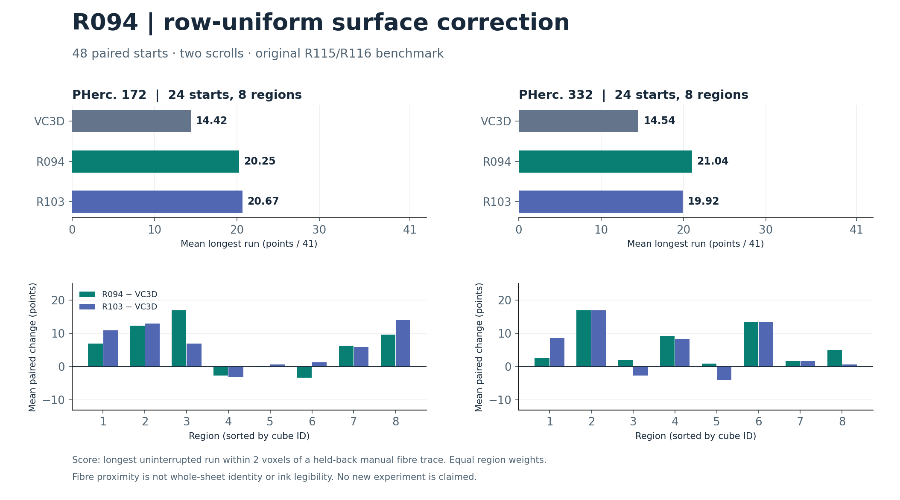
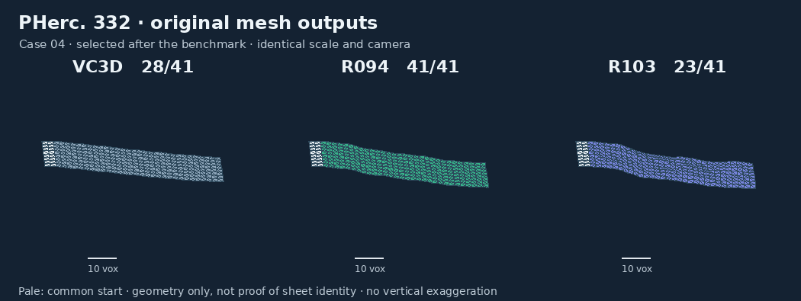

# R094 · row-uniform CT-guided correction

**Supplement to R103, submitted to the November 2026 Progress Prizes on 21 November.** R094 was already in the original repository and is one of the candidates considered by R103. This page documents the method, the previously published follow-up benchmark, and a fresh replay of five selected cases. The replay is a reproducibility check, not a new benchmark or a separate prize submission.

## Results

| Scroll | Starts / regions | VC3D | R094 | R103 | R094 vs VC3D |
|---|---:|---:|---:|---:|---:|
| PHerc. 172 | 24 / 8 | 14.42 | 20.25 | 20.67 | +40.5% |
| PHerc. 332 | 24 / 8 | 14.54 | 21.04 | 19.92 | +44.7% |
| Both panels (equal weights) | 48 / 16 | 14.48 | 20.65 | 20.29 | +42.6% |

The score is the longest uninterrupted run among 41 reference stations (+10 through +50 voxels along the held-back manual continuation) at Euclidean distance ≤2 voxels from a triangle of the extended strip. A station outside the crop breaks the sequence for all methods. Means give each region equal weight; each region has three starts. The first eight voxels of manual trace supplied the direction of the common initial strip. No continuation or reference label is supplied to the correction at inference.



The R094 mean improves in 6/8 regions on PHerc. 172 and 8/8 on PHerc. 332. Across both panels R094 exceeds R103 at 19 starts, ties at 16 and loses at 13; the combined mean advantage is small (0.354 points, +1.7%). These paired comparisons do not establish statistically significant superiority. The original Paris. 4 experiment measured a different property: target-sheet area increased from 532.46 to 559.36 voxel² with R094, but mean other-sheet area increased from 0.89 to 1.89 voxel² (R103: 589.64 and 0.11 respectively).

[Original published fibre benchmark](../r103-external-fibres.md) · [All 48 paired scores](paired-scores.csv) · [Verification record](verification.json)

## Inspect original outputs

[Download the interactive viewer](r094-3d.html), using GitHub’s Download raw file option, then open it locally in a browser. The viewer has no external runtime dependency. It contains the actual saved mesh outputs, not fitted or redrawn geometry. The animation shows Case 04 at identical scale and camera.



| Case | Scroll | VC3D | R094 | R103 | Purpose |
|---|---|---:|---:|---:|---|
| 01 | 172 | 4 | 29 | 17 | R094 gain over both methods |
| 02 | 172 | 7 | 1 | 26 | R094 loss; R103 helps |
| 03 | 332 | 6 | 41 | 41 | large gain shared by R094 and R103 |
| 04 | 332 | 28 | 41 | 23 | R094 gain over both methods |
| 05 | 332 | 41 | 27 | 15 | both corrections lose to VC3D |

The five examples were selected after scoring to illustrate gains, losses and equal outputs. In Case 03 R094 and R103 have identical coordinates. In Case 05 the baseline is better than both corrections. The geometry viewer alone cannot establish fibre visibility, absence of sheet switches, or ink legibility.

## Method and independent use

The existing [uniform correction](../r103/uniform.py) estimates a scalar displacement per longitudinal row, shared across its width but applied along each vertex's local normal. CT profiles are sampled and normalized; [dynamic programming](../r103/profile_path.py) proposes paths over discrete normal offsets (−3 to +3 voxels, step 0.5). The forward search uses the anchor profile, displacement and transition regularization; the reverse path proposes another candidate. Candidate evaluation also considers the unchanged strip and the earlier round-trip-checked profile path. The final candidate is chosen using CT-profile fit and displacement/regularity costs. Incomplete or unsuitable geometry is handled by the original code. Not every selected candidate is guaranteed to pass a round-trip check. No learned model is required.

The existing [parent-ribbon builder](../r103/parents.py) generates baseline and uniform-corrected branches. It runs at most three ten-row extensions with VC3D, preserving the last three rows as the next anchor. R094 does not need R103, but **still needs the VC3D extender**. Its output is standard `tifxyz`.

From the repository root, with an existing normalized 128³ uint8 Zarr crop in Z,Y,X order, a complete 3×9 `tifxyz` seed in the same coordinate frame, and the pinned VC3D binary:

```sh
python3 -m r103.parents --ct crop.zarr --seed seed.tifxyz \
  --out parents --extender /absolute/path/to/vc_extend_edge
```

Open `parents/R094.tifxyz` with the associated crop in VC3D, or use it in another compatible pipeline. This produces both VC3D and R094, without running `r103.correct`. See the original [reproduction instructions](../docs/REPRODUCE.md) for dependencies and binary SHA-256.

## Replay a real example locally

[examples.json](examples.json) records the five case IDs, official input TIFF URLs and SHA-256, crop origins, frozen normalized crop hashes, scores and generated output coordinates. It contains no source CT voxels or held-back manual continuation coordinates. The generated starting strip itself is included in the output meshes; its orientation was derived from the initial short manual trace. The coordinates are stored as local Z,Y,X and round-trip to the original little-endian float32 bytes. Obtain the relevant input TIFF yourself from the official server under its terms. For Case 04 use the source URL in `examples.json` and save the file locally. With NumPy installed (tifffile is optional for the uncompressed source TIFFs):

```sh
python3 r094/prepare-example.py --case 04 --volume /path/to/source.tif --out example04
python3 -m r103.parents --ct example04/ct.zarr --seed example04/seed.tifxyz \
  --out replay04 --extender /absolute/path/to/vc_extend_edge
python3 r094/prepare-example.py --case 04 --check-parents replay04
```

The preparation script checks the source TIFF hash and normalized crop hash before writing the crop, shared seed and frozen outputs. The last command checks the generated baseline and R094 coordinate digests against the frozen meshes. An exact match depends on the original extender, platform and numerical environment. On 26 November 2026 the preparation and parent-builder commands were rerun for all five cases from verified source TIFFs (four distinct files), with Python 3.10.11, NumPy 1.26.4 and the original Linux x86-64 VC3D executable in an offline local Docker environment. All ten newly generated VC3D and R094 meshes matched the archived coordinates byte for byte (25 native calls; no reuse of saved extensions between replays). R103 was not rerun. See [the replay record](replay-verification.json) for exact coordinate hashes and scope. The full 48-start benchmark was not rerun. Its original fibre distances were recomputed locally using the archived manual traces.

For local diagnostic images, install SciPy and Matplotlib in your own environment if needed, then run:

```sh
python3 r094/inspect-example.py --prepared example04 --out example04-ct.png
```

This produces three surface intensity maps and three shared CT sections at R094 rows 10, 20 and 30. Planes are defined by R094 geometry, not by the held-back fibre. Intersections use the frozen mesh triangles. Inspect the original data yourself; a diagnostic view is not a proof of complete sheet identity. The full scan and annotation data are not included. Do not redistribute locally generated CT images without checking the applicable terms.

## Data provenance and verification

- Inputs: Vesuvius Challenge, [fiber-skeletons (2025-07)](https://scrollprize.org/data_datasets#fiber-skeletons-2025-07), `Dataset004_sk-fibers-binary-20250728` (CT and WEBKNOSSOS fibre annotations); [dataset README](https://dl.ash2txt.org/datasets/fiber-skeletons/README.txt). For scan attribution see the Vesuvius Challenge CT Scans of Herculaneum Papyri citation guidance; exact acquisition versions of the fibre TIFFs are not specified in the saved input metadata. The original PHerc. Paris. 4 panel uses legacy EduceLab-Scrolls / EduceLab, University of Kentucky, [Parsons et al. (2023)](https://doi.org/10.48550/arXiv.2304.02084). Consult [official citation guidance](https://scrollprize.org/data) and the [source-server terms](https://dl.ash2txt.org/LICENSE.txt) before acquiring or redistributing data. This supplement contains generated mesh outputs (including the common starting strip) and aggregate/paired results, not source TIFFs, CT crops or original annotation traces. The data terms are separate from any software license.
- Exact source hashes and crop locations are in `examples.json`. The two original result archives have SHA-256 `4f3444256991c5e4dd82d44e8c3fe445279e29ce90114a11848af0a8b4c64848` (R115) and `bce5c5ceefd7eacc46d6f5ebbc53b4a9031a2d243861cb8d175a5f8a61460e98` (R116). Original algorithm and results are unchanged.
- Local numerical recheck: 84 manifest entries, 48 starts, 5,868 in-crop point-to-triangle distances for the three methods (36 out-of-crop entries), maximum difference 3.6e−15 voxels, all longest-run scores reproduced. Five normalized CT crops matched the original frozen SHA-256. This validates the saved computations, not the manual annotations themselves.
- Prior repository version: [`557fc647`](https://github.com/kljnepk/vc3d-surface-correction/tree/557fc647cce1663cfe1c5a63f4abcfdcf0f1b648). The original R103 results, code and documentation remain in place.
